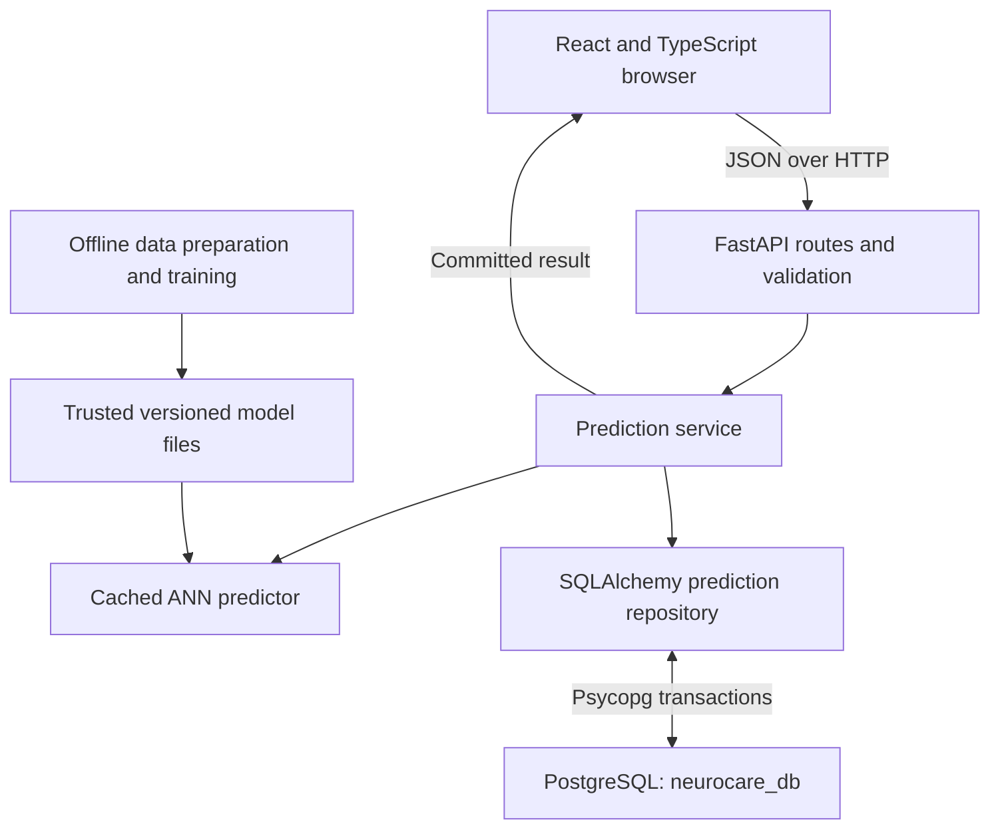
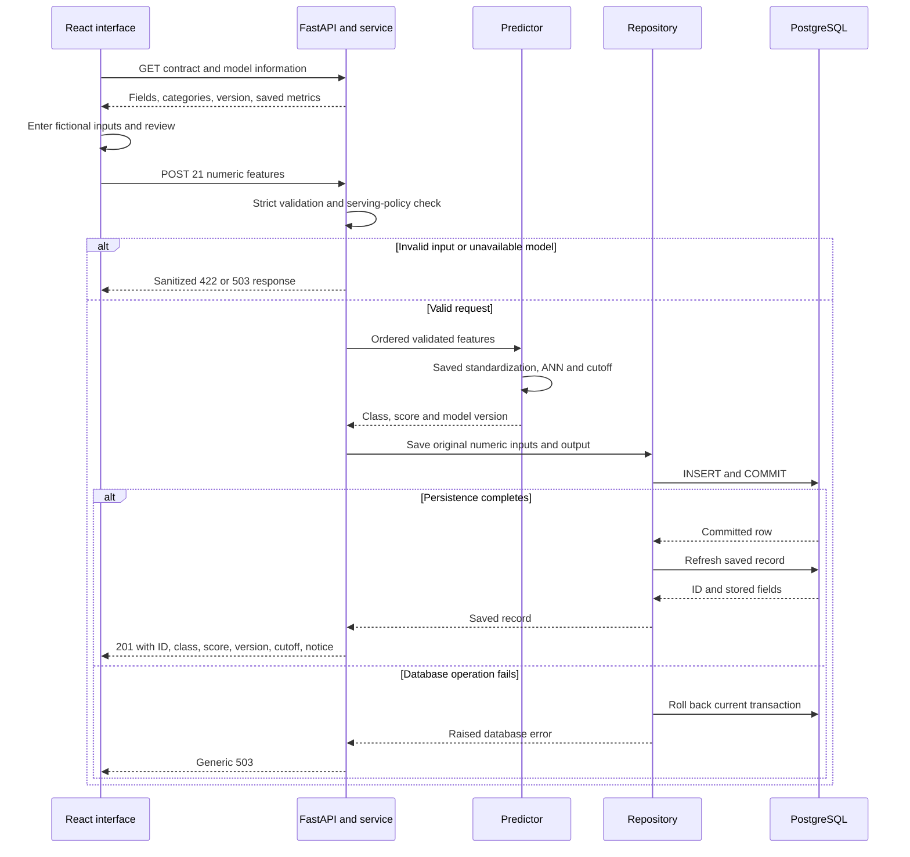
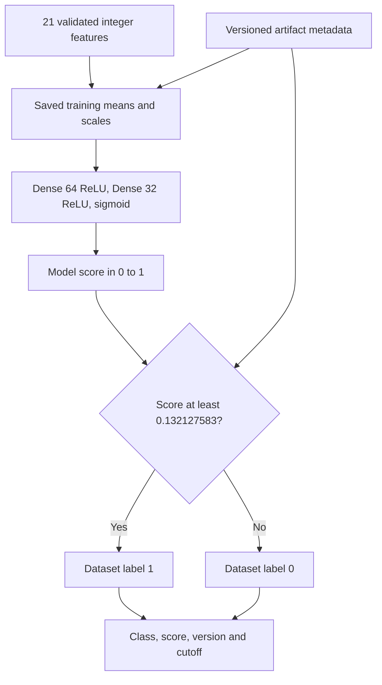

# NeuroCare AI — Architecture and Workflow

**Inspected:** 29 October 2026.  
**Configured artifact:** `20261029T043159Z-bd9e866c`.  
**Purpose:** educational classification of a historical survey label using fictional inputs.

This guide describes implemented behavior. It does not describe a clinical service, an account system or planned functionality as if it already exists. Detailed results, evidence and primary references are in [project-report.md](project-report.md).

## 1. Components and boundaries



The last arrow represents the response returned through the FastAPI route; the browser does not bypass the API to contact a service object. PostgreSQL is configured on port 5432. Its live version, schema state and row counts were not freshly verified because the documentation-run read-only probe failed.

| Boundary | Implementation |
| --- | --- |
| Browser | Public pages, form state, client validation, review and presentation; no localStorage persistence of prediction answers |
| HTTP | Axios requests to FastAPI; configurable origin and bounded timeouts |
| Validation | Pydantic rejects missing/extra fields, non-integer JSON values and out-of-range codes |
| Service | Calls inference, then persistence, and assembles the response/notice |
| Predictor | Orders features, standardizes with training-only statistics, runs the saved network and applies its threshold |
| Repository | Adds a prediction, commits, refreshes it and rolls back the current transaction on errors |
| Database | Stores input JSONB, class, score, version, ID and timestamp |
| Offline workflow | Converts data, splits/groups records, fits preprocessing, trains/selects a candidate and saves provenance |

## 2. Request and transaction sequence



The diagram compresses framework dependency handling; session creation and model loading are not guaranteed to occur in the precise visual order of every validation step. The important invariant is that a successful response follows the repository save.

Commit is a distinct event from response delivery. A failure during a later refresh or a network timeout may occur after a row was committed; rollback cannot undo an earlier completed transaction. Consequently, an error or lost response is not proof that no record exists. Automatic POST retry is deliberately absent, and server-side idempotency keys are not implemented.

## 3. Model workflow



The threshold is shortened in the diagram; its exact saved value is `0.132127583026886`. Both hidden kernels use L2 0.0001. Dropout 0.1 follows each hidden layer during training and is disabled for inference. The score is not established as a calibrated personal probability.

The current model has two hidden dense layers plus one output dense layer. Its 3,521 parameters are derived from the saved architecture, including biases. The original `app.ml.train` defines a different, smaller 2015 network; it is not the architecture used by the active artifact.

## 4. Offline preparation and training

| Step | Implemented behavior |
| --- | --- |
| Convert | Map documented BRFSS 2021 variables to the fixed 21-feature contract; preserve the raw XPORT file |
| Handle missingness | Exclude unsupported/missing required values; never silently turn unknown responses into No |
| Protect historical holdouts | Quarantine 13,776 matching profiles; force 20,789 historical training matches into training only |
| Split | Group identical input profiles; use five stratified group folds for novel profiles, seed 42 |
| Fit preprocessing | Calculate means and population standard deviations from training only |
| Train | Compare fresh and transferred 64/32 ANNs with Adam/BCE, dropout, L2, early stopping and learning-rate reduction |
| Select | Use validation metrics and a frozen validation recall floor; do not search cutoffs on test labels |
| Save | Save model, preprocessing, split/source indices, metrics, hashes and version information |
| Evaluate | Report the frozen model/cutoff on held-out rows; acknowledge the subsequent reuse of this test partition |

The active artifact restores the original 2021 validation-selected operating point. This restoration changes no learned weights. The retired accuracy-first artifact remains available offline but is rejected by current public 2021 serving guards.

## 5. Database and API boundary

The source migration defines `users`, `predictions` and Alembic's revision tracking. `users` is a reserved, unexposed entity with no implemented authentication flow. `predictions.patient_reference` is a nullable legacy column, but the public input schema rejects such identifying fields. There is no prediction-to-user foreign key.

The business API consists of five GET routes—application health, database health, API identity, model contract and model details—and one POST prediction route. There is no public history/user retrieval route. FastAPI additionally supplies generated documentation.

The result threshold is returned from the current artifact, not stored directly in the prediction row. Historical reproducibility therefore requires preserving the model artifact associated with each stored `model_version`.

## 6. Configuration, startup and failure behavior

The existing single-command launcher is:

```powershell
.\scripts\dev.ps1 start
```

It reuses healthy application services and the existing PostgreSQL service, applies migrations, starts missing application processes and checks readiness. It never manages an unrelated PostgreSQL service on 5432. Cleanup is restricted to API/frontend processes owned by that launcher invocation. These properties were inspected, not re-exercised in this documentation task.

Settings normally use separate database fields; an explicit `DATABASE_URL` takes precedence. Credentials are not reproduced in these documents. Process-local settings and model caches mean that configuration changes require an API restart. No configuration change was made for this report.

Errors are explicit: 422 for input validation, 503 for unavailable model/database operations, and generic 500 for unexpected exceptions. The frontend keeps unsent/current answers when a request fails, shows missing data as unavailable and does not fabricate saved results.

## 7. Verification boundaries

This documentation run passed 127 selected backend tests, 27 frontend tests, lint, type checking, a production build and the independent model audit. Three selected HTTP cases were deselected; the full HTTP/database suite was not executed. The read-only database connection attempt failed without changing records.

Earlier browser evidence records a real HTTP 201 and retained fictional row #6, plus responsive/control checks. It was inspected rather than rerun here. Clinical validity, physical-touch behavior, a complete screen-reader audit and public-deployment security remain unverified.

See [verification-results.json](verification-results.json), [model-audit.json](model-audit.json), [runtime-check.json](runtime-check.json) and the full report for source attribution and precise scope.
