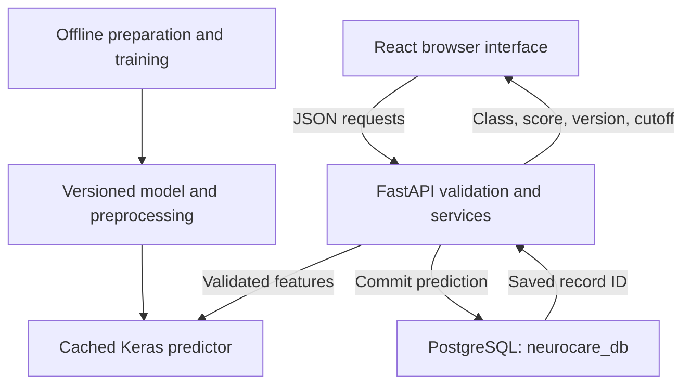

# NeuroCare AI: An Educational Neural-Network Classification System

**Academic project report — 29 October 2026**  
**Scope:** the inspected local implementation and its configured BRFSS 2021 model.  
**Submission information:** the student's name, university, course, supervisor and required citation style were not supplied. These administrative details should be added before submission.

## Abstract

NeuroCare AI is a university software and machine-learning project that demonstrates classification of a diabetes-related label in a historical public health survey. It connects a React/TypeScript interface, a FastAPI service, a TensorFlow/Keras artificial neural network (ANN), and PostgreSQL persistence. Users enter a fictional profile containing 21 coded survey features, review their answers, and receive the model's class, score, version and decision threshold after a database save. The application is an educational prototype, not a diagnostic, screening or individual future-risk tool.

The configured model uses a processed cohort of 222,600 BRFSS 2021 records. Its ANN has two hidden dense layers of 64 and 32 units and a sigmoid output. On 40,376 previously evaluated test records, the model achieves 67.04% accuracy, 29.78% precision, 82.82% recall and ROC AUC 0.8129. F1, calculated for this report from the saved confusion matrix, is 0.4381. These results indicate useful ranking of survey labels within this cohort but substantial classification errors: 1,076 positive labels are missed and 12,231 negative labels are flagged positive. They do not establish clinical validity or reliable performance in another population.

The documentation exercise reran 127 selected backend tests and 27 frontend tests, lint, type checking, the production build and an independent model-integrity audit. Three selected HTTP tests were deselected; the complete backend suite and database-writing integration tests were not run. A read-only database probe could not complete in this execution context. Earlier browser verification is identified separately from checks executed for this report. Application source, model, database records and configuration were not changed to produce this documentation.

## Contents

1. Introduction and objectives
2. Technical stack and engineering rationale
3. System architecture
4. Dataset and data preparation
5. ANN algorithm and methodology
6. Model evaluation and results
7. End-to-end workflow
8. Database and API
9. Frontend and user experience
10. Security, privacy and responsible use
11. Testing and reliability
12. Strengths, weaknesses and limitations
13. Conclusion and future improvements
14. References and glossary

## 1. Introduction and objectives

### 1.1 Purpose and problem addressed

An isolated trained model does not demonstrate how a complete machine-learning application works. Inputs must have consistent meanings, validation must reject invalid values, the same preprocessing must be used in training and inference, and stored results must identify the model that produced them. NeuroCare addresses these engineering requirements through an inspectable educational application.

The documented objective is to connect a real ANN with a working interface and persistent backend while explaining the evidence and limitations. Its subject is classification of a **survey label**, not diagnosis from clinical measurements. Although API and interface terminology includes “prediction,” the implementation does not estimate the probability of future diabetes or establish an individual's health status.

### 1.2 Specific objectives

The implemented objectives are to expose the exact 21-feature contract; preserve source category meanings; demonstrate offline model preparation and training; serve a versioned model without retraining per request; validate submissions on both client and server; store successful outputs transactionally; and present evaluation alongside limitations. The website also makes architecture, dataset provenance and educational-use guidance visible.

No authentication, account registration, private dashboard, public prediction-history browser, clinical integration or production hosting is implemented. An existing `users` table does not constitute an account system.

### 1.3 Evidence method

Project-specific findings come from the current source, dependency manifests, loaded configuration inspected without revealing secrets, saved model/cohort files, training search records, migrations, existing verification records and newly executed checks. Primary technical references explain the methods; they do not verify the application's results.

For this report, **implemented** means present in inspected source; **verified in this documentation run** means a check was actually executed; **earlier verification** means a recorded previous check; and **not verified** means evidence is insufficient. Engineering suitability explanations are reasoned assessments of the implementation, not claims about undocumented author intentions.

## 2. Technical stack and engineering rationale

The table reports versions inspected in the local environment or frontend installation. Versions in current online documentation may be newer; those references are used for concepts rather than as evidence of installed versions.

| Technology | Inspected version/use | Responsibility and suitability |
| --- | --- | --- |
| Python | 3.11.9 | Backend, data conversion, training, evaluation and audit scripts share one language and data ecosystem. |
| TypeScript | 5.8.3 | Describes frontend field/model/response shapes and catches many development-time mistakes; it does not replace server validation. |
| React and React DOM | 19.0.0 | Reusable components and local state implement the guided form, navigation and result views. [R16] |
| React Router | 7.5.1 | Connects real public routes and section anchors within the single-page application. |
| Vite | 6.3.3 | Development server, hot reload and production bundling. Port 5173 is strict, avoiding unnoticed port changes. [R18] |
| CSS and Tailwind CSS | Tailwind 4.1.4 | Tailwind is imported through the Vite plugin; shared handcrafted CSS tokens/components provide most visible styling. |
| Axios | 1.8.4 | Centralizes the API base URL, timeouts and cancellation. [R19] |
| Lucide React | 0.468.0 | Supplies consistent interface icons. |
| Recharts | 3.0.2, installed | Available dependency, but current architecture/outcome visuals use SVG/CSS rather than an active chart-library dashboard. |
| FastAPI | 0.115.12 | Typed HTTP endpoints, dependency injection, generated OpenAPI and interactive API documentation. [R11] |
| Uvicorn | 0.34.2 | Runs the ASGI backend locally on loopback port 8000. |
| Pydantic / pydantic-settings | 2.11.4 / direct pin 2.9.1 | Strict request models and environment-backed settings. Invalid fields are rejected before inference/persistence. [R12] |
| SQLAlchemy | 2.0.40 | Maps Python objects to relational tables and provides transactional sessions. [R13] |
| Psycopg | 3.2.9 | PostgreSQL driver used by SQLAlchemy. |
| PostgreSQL | Existing configured service on 5432 | Durable relational records and JSONB input storage. Compose specifies `postgres:18`; the running service version was not verified in this documentation run. [R14] |
| Alembic | 1.15.2 | Versioned database schema management, with initial revision `0001`. [R15] |
| pandas / NumPy | 2.2.3 / 2.1.3 | XPORT conversion, tabular operations, numeric arrays and saved split handling. |
| scikit-learn | 1.6.1 | Grouped splitting, logistic-regression comparisons and classification metrics. [R7–R9] |
| TensorFlow / Keras | 2.19.0 / 3.15.1 | ANN construction, optimization, regularization, serialization and inference. [R3–R6] |
| pytest / Ruff | 8.3.5 / 0.11.8 | Backend regression tests and static lint checks. |
| Node.js / npm / ESLint | Node 26.3.1; ESLint 9.25.1 | Frontend tooling, dependency management, regression tests and lint. |
| PowerShell | Project launcher scripts | Provides the existing single-command local startup and targeted service cleanup. |
| Docker Compose | Optional database definition | Alternative database provisioning; it is not required for the selected existing PostgreSQL service. |

React is suitable for the stateful multi-step interface; a server-rendered template approach could reduce frontend tooling for a smaller form. FastAPI keeps model-serving code close to the Python ML implementation; another backend framework could work but would require recreating these contracts. PostgreSQL offers a durable service independent of application restarts; SQLite could simplify a standalone prototype but would not demonstrate the same client/server database stack. An ANN supports the project's educational objectives, but its use is not evidence of superiority over simpler tabular-data models.

## 3. System architecture

### 3.1 Separation of responsibilities

The browser handles presentation, temporary form state and client validation. FastAPI provides the public contract and validates requests. A service coordinates inference and persistence. A repository commits prediction rows through SQLAlchemy/Psycopg. The predictor loads a trusted local Keras artifact and saved preprocessing. Offline training is separate from HTTP inference.



The dependency direction supports independent testing: service tests can use controlled predictor/session doubles, while artifact tests load the actual model. These test types prove different things; simulated sessions do not prove a live PostgreSQL save.

### 3.2 Important boundaries

The inference path does not call training. Keras loads with compilation disabled and `safe_mode=True`, and inference uses `training=False`. Saved feature order is enforced independently of JSON key order. Configuration and predictor objects are cached within a process, so changing a model directory requires an API restart to replace cached state.

The database is not replaced by browser storage or a local JSON file. Successful responses follow a database commit, while unavailable services produce explicit errors. Public business endpoints expose model information and submission, not a history listing.

### 3.3 Development startup

The documented root command is:

```powershell
.\scripts\dev.ps1 start
```

The launcher checks existing application listeners, reuses healthy project services, checks PostgreSQL readiness, applies migrations and starts only missing API/frontend processes. It records process ownership so cleanup stops only the application processes it started. PostgreSQL on 5432 is independently managed; helper guards refuse to launch, rebind or stop a project cluster on that port. This behavior was inspected in source, not re-executed during the documentation run because startup may apply migrations.

See [architecture.md](architecture.md) for component boundaries and a transaction sequence.

## 4. Dataset and data preparation

### 4.1 Actual source and retained data

The active model uses the **CDC Behavioral Risk Factor Surveillance System (BRFSS) 2021** public survey wave. The raw file is `data/raw/LLCP2021.XPT`; the processed file is `data/processed/diabetes_binary_health_indicators_BRFSS2021.csv`, with a conversion/provenance JSON beside it. The CDC annual documentation and codebook identify the source variables. [R1, R2]

| Preparation stage | Records | Class 0 | Class 1 | Evidence |
| --- | ---: | ---: | ---: | --- |
| Original 2021 wave | 438,693 | Not recomputed here | Not recomputed here | Conversion manifest and official wave documentation |
| Complete supported cases | 236,376 | 202,810 | 33,566 | Conversion manifest |
| Final model cohort | 222,600 | 189,881 | 32,719 | Configured cohort and metadata |

Conversion excluded 202,317 raw records, approximately 46.12%, because one or more required values were missing, unsupported or outside the supported contract. An additional 13,776 processed rows were quarantined for cross-year profile overlap. These are different exclusion stages. The raw source was preserved; excluded responses were not repaired by inventing answers. The full XPORT conversion was not rerun for this report.

### 4.2 Target definition

The stored CSV target is named `Diabetes_binary`. For this 2021 conversion it is derived explicitly from `DIABETE4`:

| Original response | Converted label |
| --- | --- |
| Yes | 1 |
| Yes, during pregnancy only | 0 |
| No | 0 |
| No, prediabetes or borderline diabetes | 0 |
| Unknown, refused or missing | Excluded |

Consequently, label 0 is not proof of absence of every diabetes-related condition. The outcome is a recoded self-reported survey response, not an independently verified laboratory diagnosis. The precise historical recoding of the older cleaned 2015 file is not verified as identical to this definition.

### 4.3 Input features and encoding

All API inputs are required integers. Unless otherwise stated below, a binary indicator uses 0 for No and 1 for Yes after conversion. The exact raw variable mapping is implemented in `app/ml/brfss2021.py` and the numeric bounds in `app/ml/data.py`.

| Feature | Meaning and accepted coding | 2021 source |
| --- | --- | --- |
| `HighBP` | High blood pressure indicator, 0–1 | `_RFHYPE6` |
| `HighChol` | Told cholesterol was high, 0–1 | `TOLDHI3` |
| `CholCheck` | Cholesterol checked within five years, 0–1 | `_CHOLCH3` |
| `BMI` | Rounded body mass index, integer 12–98 | `_BMI5 / 100`, rounded |
| `Smoker` | At least 100 cigarettes during lifetime, 0–1 | `SMOKE100` |
| `Stroke` | History of stroke, 0–1 | `CVDSTRK3` |
| `HeartDiseaseorAttack` | Coronary heart disease or heart attack indicator, 0–1 | `_MICHD` |
| `PhysActivity` | Activity outside work in the past 30 days, 0–1 | `_TOTINDA` |
| `Fruits` | Fruit at least daily, 0–1 | `_FRTLT1A` |
| `Veggies` | Vegetables at least daily, 0–1 | `_VEGLT1A` |
| `HvyAlcoholConsump` | Source heavy-alcohol indicator, 0–1 | `_RFDRHV7` |
| `AnyHealthcare` | Healthcare coverage indicator, 0–1 | `_HLTHPLN` |
| `NoDocbcCost` | Could not see a doctor because of cost, 0–1 | `MEDCOST1` |
| `GenHlth` | 1 Excellent; 2 Very good; 3 Good; 4 Fair; 5 Poor | `GENHLTH` |
| `MentHlth` | Days mental health was not good, 0–30 | `MENTHLTH` |
| `PhysHlth` | Days physical health was not good, 0–30 | `PHYSHLTH` |
| `DiffWalk` | Serious difficulty walking/climbing stairs, 0–1 | `DIFFWALK` |
| `Sex` | Source coding: 0 Female, 1 Male | `SEXVAR`, recoded |
| `Age` | Thirteen source age bands, 1–13, not age in years | `_AGEG5YR` |
| `Education` | Six ordered education categories, 1–6 | `EDUCA` |
| `Income` | Eight household-income bands, 1–8, in 2021 nominal USD | `INCOME3`, upper bands combined |

Age categories run from 18–24 through five-year bands to 75–79, followed by 80 or older. Education ranges from never attended/kindergarten to four or more college years. Income bands are under $10,000; $10,000–14,999; $15,000–19,999; $20,000–24,999; $25,000–34,999; $35,000–49,999; $50,000–74,999; and $75,000 or more. Raw 2021 income categories 8–11 are merged into the final upper band. No inflation adjustment is applied.

These are numeric category encodings, not one-hot encodings. Processing category codes numerically is simple and compatible with the 21-input model, but can introduce unhelpful assumptions about ordering or distances. The sex field describes the source's two-category encoding; it is not a complete representation of sex or gender in a wider population.

### 4.4 Missing values and validation

Only explicitly supported raw codes are mapped. Unknown/refused responses remain missing and are excluded by complete-case filtering. Code 88 becomes zero **only** for the mental/physical health-day fields. BMI's two implied decimal places are restored, then rounded to an integer using ties-to-even rounding; out-of-range values are excluded rather than clipped.

The processed CSV must contain exactly the target and 21 named features. Each value is checked for numeric finiteness, integer coding and allowed range. These checks prevent malformed source files from silently changing the inference contract. They do not remove self-report error or selection bias.

### 4.5 Splitting and cross-year overlap protection

An earlier 2015 dataset and model were used for development and transfer initialization. The 2021 workflow does not simply concatenate both years. It removes profiles matching earlier held-out profiles and forces 20,789 matches to prior training profiles into training only. Novel profiles are divided with five shuffled, stratified group folds and seed 42. Identical feature profiles remain in one partition, even if their labels differ. Group stratification aims to preserve label balance subject to the grouping constraint. [R8]

| Partition | Records | Class 0 | Class 1 | Fraction of final cohort |
| --- | ---: | ---: | ---: | ---: |
| Training | 141,834 | 121,679 | 20,155 | 63.72% |
| Validation | 40,390 | 34,090 | 6,300 | 18.14% |
| Test | 40,376 | 34,112 | 6,264 | 18.14% |
| Total | 222,600 | 189,881 | 32,719 | 100.00% |

The final proportions differ from a simple 60/20/20 split because historical training matches are added to training only. Profile grouping is not person identification: different answers from the same person cannot be linked without an identifier. The current audit verified zero identical-profile overlap across current partitions; the earlier full lineage audit records exclusion of historical profiles.

### 4.6 Training-only standardization

For each feature, the preprocessor stores the training mean and population standard deviation:

$$z_j=\frac{x_j-\mu_{j,\mathrm{train}}}{\sigma_{j,\mathrm{train}}}.$$

A zero standard deviation is replaced by 1. The same saved statistics transform validation, test and request inputs; they are not refitted when a request arrives. Standardization reduces scale differences between, for example, BMI and binary indicators. Fitting it only on training data avoids leaking held-out distribution information into model preparation.

## 5. ANN algorithm and methodology

### 5.1 Actual configured architecture

The report concerns artifact `20261029T043159Z-bd9e866c`, not the smaller network defined in the original generic training CLI. Its saved Keras archive and parent training manifest agree on this architecture:

| Stage | Units / setting | Function |
| --- | --- | --- |
| Input | 21 standardized features | Fixed source-feature order |
| Hidden dense layer 1 | 64 units, ReLU, kernel L2 = 0.0001 | Learns combinations of the inputs |
| Dropout 1 | Rate 0.1 during training | Reduces reliance on particular hidden activations |
| Hidden dense layer 2 | 32 units, ReLU, kernel L2 = 0.0001 | Learns further nonlinear combinations |
| Dropout 2 | Rate 0.1 during training | Additional regularization |
| Output dense layer | 1 unit, sigmoid | Produces a score in [0, 1] |

There are **two hidden dense layers and one output dense layer**; dropout layers do not introduce learned neurons. Including the input representation, the table has six stages. The parameter count derived from these dimensions is:

$$(21+1)64+(64+1)32+(32+1)1=3,521.$$

The terms include biases. The SVG displayed by the website draws representative nodes/connections and labels the actual unit counts; it is not a visualization of learned weights or live neuron activations. Dense and dropout behavior are described in the Keras documentation. [R3, R4]

### 5.2 Forward propagation

A dense layer forms weighted combinations and adds a bias. For inference, the network can be written as:

$$h_1=\operatorname{ReLU}(W_1z+b_1),\qquad h_2=\operatorname{ReLU}(W_2h_1+b_2),$$
$$s=\sigma(W_3h_2+b_3),\qquad \operatorname{ReLU}(u)=\max(0,u),\quad \sigma(u)=\frac{1}{1+e^{-u}}.$$

ReLU allows nonlinear relationships rather than a single linear boundary. The sigmoid constrains the output score. During training dropout is applied between dense layers; during inference it is disabled. A sigmoid score is not automatically a calibrated personal probability.

The class decision uses the saved threshold:

$$\hat y=\begin{cases}1,&s\geq0.132127583026886,\\0,&s<0.132127583026886.\end{cases}$$

This relatively low threshold deliberately emphasizes finding positive survey labels, with more false positives as a consequence.

### 5.3 Loss, backpropagation and optimizer

Training minimizes binary cross-entropy plus the hidden-layer L2 penalties:

$$\mathcal L=-\frac{1}{B}\sum_{i=1}^{B}\left[y_i\log s_i+(1-y_i)\log(1-s_i)\right]+\lambda\left(\lVert W_1\rVert_F^2+\lVert W_2\rVert_F^2\right),\qquad\lambda=10^{-4}.$$

Here, (B) is the batch size and the norms sum squared hidden-layer kernel weights. Binary cross-entropy penalizes scores inconsistent with the known labels. L2 discourages unnecessarily large weights. Neither mechanism guarantees clinical relevance.

Backpropagation uses the chain rule to calculate how changes to each weight affect loss. The optimizer then updates weights over successive mini-batches. Adam keeps moving estimates of gradients and their squared values to adapt updates per parameter. [R5] In abbreviated form:

$$g_t=\nabla_\theta\mathcal L_t,\quad m_t=\beta_1m_{t-1}+(1-\beta_1)g_t,\quad v_t=\beta_2v_{t-1}+(1-\beta_2)g_t^2,$$
$$\theta_{t+1}=\theta_t-\alpha_t\frac{\hat m_t}{\sqrt{\hat v_t}+\epsilon}.$$

The source explicitly sets the learning rate; other Adam arguments use library defaults rather than project-specific tuning. The report does not attribute unconfigured optimizer choices to the author.

### 5.4 Training history and selected hyperparameters

The saved 2021 experiment compared a fresh network with a transferred/fine-tuned network. Candidate configuration was selected by validation accuracy, then average precision, then lower Brier score, after applying a shared validation recall constraint. The winning transfer configuration is preserved in the active artifact.

| Parameter | Configured or recorded value |
| --- | --- |
| Initial learning rate | 0.0001 for the selected transfer run |
| Optimizer / loss | Adam / binary cross-entropy, with layer L2 losses |
| Batch size | 512 |
| Maximum epochs | 60 |
| Completed epochs | 19 in the selected transfer trial |
| Lowest saved validation-loss epoch | 11, derived from the trial history |
| Early stopping | Validation loss, patience 8, restore best weights |
| Learning-rate schedule | Multiply by 0.5 after 3 plateau epochs; minimum 0.00001 |
| Dropout / L2 | 0.1 per hidden layer / 0.0001 per hidden kernel |
| Random seed | 42 |
| Class weighting / survey weighting | Neither used |
| Initialization | Preserved 2015 model weights, with first-layer rescaling adaptation |

An epoch is one traversal of the training dataset. A batch is the subset used for one optimization step. Early stopping selects weights from a better validation-loss epoch instead of necessarily using the last epoch. [R6] A fixed seed and deterministic-operation settings improve reproducibility but are not a guarantee of bitwise equality across hardware and library environments.

The transfer process adjusts the first layer when changing training-only normalization. If old and new normalizers are ((\mu_o,\sigma_o)) and ((\mu_n,\sigma_n)), its row-vector implementation uses:

$$W_n=\operatorname{diag}(\sigma_n/\sigma_o)W_o,\qquad b_n=b_o+((\mu_n-\mu_o)/\sigma_o)W_o.$$

This preserves the warm-start function before fine-tuning. A regression test checks that property. Transfer training subsequently changes the weights; the later accuracy-policy experiment and current recall restoration do not retrain them.

### 5.5 Decision-policy selection and version history

The selected validation objective is **maximum accuracy subject to a recall floor of 0.8325396825**. That floor was derived in the original 2021 experiment from the parent model's validation recall, with a minimum of 0.8. Ties prefer greater recall and then a higher threshold. The threshold search uses validation labels, not test labels. This separates learning the score from deciding which score triggers label 1. [R7]

The original 2021 weights are in `20261028T222429Z-e5a45f4d`. A later variant raised the threshold to obtain 85.01% test accuracy but only 13.95% recall. It was retired. The active version restores the original validation-selected 2021 threshold while preserving separate artifact identities and unchanged weights.

Public 2021 serving now requires explicit reviewed status, validation-only recall-constrained selection, a validation recall floor of at least 80%, validation results meeting that floor, and measured test recall of at least 80%. These are internal project review guards, **not medical standards or guarantees**. Test-based deployment review and repeated development decisions also mean the reported test partition must not be described as a new untouched independent benchmark.

## 6. Model evaluation and results

### 6.1 Current test results

The documentation-run audit independently recomputed the saved metrics, scaling and threshold without fitting a model. The following results apply to the same 40,376 held-out records previously used in project evaluation.

| Metric | Result | Interpretation |
| --- | ---: | --- |
| Accuracy | 67.0423% | Fraction of all test records classified correctly |
| Precision | 29.7836% | Fraction of predicted positives with positive survey labels |
| Recall / sensitivity | 82.8225% | Fraction of actual positive labels detected |
| F1 | 0.438120 | Harmonic mean of precision and recall; derived here from saved counts |
| Specificity | 64.1446% | Fraction of negative labels classified negative |
| F2 | 0.610712 | Harmonic measure placing more emphasis on recall |
| ROC AUC | 0.812885 | Ranking measure across possible thresholds |
| Average precision | 0.429336 | Precision–recall ranking summary as computed by scikit-learn |
| Brier score | 0.107429 | Mean squared difference between scores and binary labels; lower is better |
| Balanced accuracy | 73.4835% | Mean of recall and specificity; derived here from saved counts |
| Decision threshold | 0.1321275830 | Score cutoff used to return the class |

F1 and balanced accuracy are additional calculations for this report, not fields claimed to have been saved by the existing evaluation function or returned by the API. ROC AUC is not classification accuracy, and average precision is not described here as an independently calculated trapezoidal PR-curve area. [R9]

### 6.2 Confusion matrix and metric equations

Rows are actual survey labels and columns are predicted labels:

| Actual label | Predicted 0 | Predicted 1 | Total |
| --- | ---: | ---: | ---: |
| 0 | TN = 21,881 | FP = 12,231 | 34,112 |
| 1 | FN = 1,076 | TP = 5,188 | 6,264 |
| Total | 22,957 | 17,419 | 40,376 |

True positive (TP) and true negative (TN) are correct predictions. False negative (FN) means a positive survey label was missed; false positive (FP) means a negative label was flagged.

$$\mathrm{Accuracy}=\frac{TP+TN}{N},\quad\mathrm{Precision}=\frac{TP}{TP+FP},\quad\mathrm{Recall}=\frac{TP}{TP+FN},$$
$$F_1=\frac{2TP}{2TP+FP+FN}=\frac{10,376}{23,683}=0.438120,\quad\mathrm{Specificity}=\frac{TN}{TN+FP},$$
$$F_\beta=\frac{(1+\beta^2)PR}{\beta^2P+R},\quad\mathrm{Brier}=\frac{1}{N}\sum_i(s_i-y_i)^2.$$

The cutoff finds about 83 of every 100 positive labels in this test set, but roughly 70% of its positive predictions are false positives. Its relatively high recall therefore cannot be presented without its low precision and missed cases.

### 6.3 Validation versus test

Validation accuracy is 67.3137%, recall 83.2540%, precision 30.1575% and ROC AUC 0.815420. These are close to the test values, which is reassuring within this cohort. Similar point estimates do not exclude overfitting, dataset shift or selection bias. The held-out data is not a prospectively collected clinical validation cohort.

### 6.4 Baselines and the misleading accuracy target

| Model/policy on the same 2021 test cohort | Accuracy | Precision | Recall | ROC AUC |
| --- | ---: | ---: | ---: | ---: |
| Active recall-focused ANN | 67.04% | 29.78% | 82.82% | 0.8129 |
| Prior 2015 ANN evaluated on these 2021 rows | 67.07% | 29.73% | 82.31% | 0.8114 |
| Logistic-regression reference | 65.98% | 29.07% | 82.85% | 0.8051 |
| Retired accuracy-focused cutoff, same 2021 ANN weights | 85.01% | 56.90% | 13.95% | 0.8129 |
| Always predict 0, derived from test class counts | 84.49% | Not meaningful | 0.00% | Not reported |

Only 15.51% of the test records have label 1. A rule predicting 0 for every record therefore obtains 84.49% accuracy while finding none of the positive labels. This illustrates why optimizing accuracy alone can be misleading for this imbalanced dataset. [R10]

The active ANN does not improve overall accuracy over the prior ANN on the same 2021 rows: the difference is approximately −0.0322 percentage points. The saved parent comparison reports a profile-cluster bootstrap 95% interval of approximately −0.1807 to +0.1139 percentage points for the accuracy difference, which includes zero. That historical interval was inspected, not recomputed in this documentation run. A reliable improvement over the parent is not established.

Raising a threshold changes class decisions, precision and recall; it does not improve the learned ranking. The identical ROC AUC of the active and retired 2021 operating points is therefore expected. Historical 2015 test accuracy of approximately 68.96% belongs to a different cohort and must not be treated as a direct before/after comparison with 2021 performance.

### 6.5 Overfitting, generalization and leakage

Overfitting occurs when learned patterns or development decisions fit available development data better than genuinely new examples. Dropout, L2 and validation-loss early stopping address some model-fitting risks. They do not correct self-report bias or make repeated test-set reuse independent.

Generalization means performance beyond the training/development records. The project has no verified prospective, independent clinical evaluation, current-population calibration or subgroup fairness study. No claim of suitability for another country, time period or healthcare setting follows from the reported metrics.

Data leakage is unintended use of held-out information in training or selection. Training-only normalization, grouped partitions and cross-year quarantine reduce identifiable leakage paths. They cannot verify participant identity, prove absence of every leakage mechanism, or undo the effects of repeated human evaluation of the same test set. Brier score alone does not establish calibration; no reliability diagram or subgroup calibration audit is provided.

## 7. End-to-end workflow

1. The browser opens a public route and loads the input contract and model metadata. Missing information produces a loading/unavailable state rather than substitute predictions or metrics.
2. The user creates a fictional profile through Background, Health, Daily life and Wellbeing groups. Values remain in React state; zero is preserved as a valid answer.
3. Client validation checks presence, integer values and source bounds. The user reviews all 21 answers and may edit earlier groups without losing other answers.
4. On submission, Axios sends JSON to `POST /api/v1/predictions`. A submission lock prevents concurrent duplicate clicks, and requests are not automatically retried.
5. FastAPI/Pydantic rejects missing/extra fields, wrong types and out-of-range values with a sanitized 422 response.
6. The predictor validates the configured artifact/serving contract, orders inputs by `FEATURES`, applies saved training statistics, and evaluates the ANN with dropout disabled.
7. The sigmoid score is compared with the saved threshold to generate class 0 or 1.
8. The repository adds a prediction row, commits and refreshes it. On failure it rolls back and raises an error; there is no success response claiming an unsaved result.
9. A 201 response returns the record ID, class, score, model version, threshold and educational/policy notice. The interface displays these actual values and moves focus to the result heading.
10. “Try another profile” clears browser form state. It does not delete the stored row or expose anyone else's history.

A network timeout may occur after a successful commit, so a lost response does not prove that no row was saved. The frontend explains this uncertainty. There is no server-side idempotency-key implementation; a manual repeat could create another record.

## 8. Database and API

### 8.1 Schema

The models and migration define the following application tables:

| Table | Columns and constraints | Actual role |
| --- | --- | --- |
| `users` | Integer primary key; name up to 120 characters; unique email up to 254; timezone-aware creation timestamp | Reserved entity; no public user/account/authentication API is implemented |
| `predictions` | Integer primary key; nullable indexed `patient_reference` up to 100; required `input_data` JSONB; nullable class, score and model-version columns; indexed timezone-aware timestamp | Stores submitted synthetic features and model output |
| `alembic_version` | Migration revision managed by Alembic | Records applied schema state; source migration is `0001` |

The probability column has a database check for values between 0 and 1. Several output fields remain nullable for legacy schema compatibility, and the source migration does not add a class-0/1 constraint. Public validation and predictor logic impose stronger current behavior than these database columns alone.

The public input contract rejects `patient_reference`, names and email as extra fields. `Prediction` has no user foreign key, and the unused users table is not linked to public submissions. The API returns a threshold, but the prediction table does **not** store that threshold directly; reproducing an old decision depends on preserving the artifact identified by `model_version`.

JSONB fits the current small, fixed feature payload while relational columns support identity, timestamps and output provenance. [R14] A future stricter data model could explicitly version the input schema and persist the decision policy with each result.

### 8.2 Public business endpoints

| Method and path | Purpose | Normal success |
| --- | --- | --- |
| `GET /api/health` | Application liveness | 200, status `ok` |
| `GET /api/health/db` | Real database `SELECT 1` health check | 200 with database connected |
| `GET /api/v1/` | API identity and version | 200 |
| `GET /api/v1/model/contract` | Exact fields, ranges/options, target and source semantics | 200; missing model may permit default contract inspection |
| `GET /api/v1/model` | Configured model version, cutoff, saved metrics, architecture, training/source details and limits | 200, or 503 if the configured model cannot be served |
| `POST /api/v1/predictions` | Validate, infer and commit a submission | 201 only after save |

FastAPI also provides `/docs` and `/openapi.json`; these are generated documentation endpoints rather than history APIs. There is no public GET endpoint for saved predictions or users. [R11]

A successful prediction response has this field structure, without fabricated example values:

| Field | Type / meaning |
| --- | --- |
| `id` | Integer identifier of the committed record |
| `predicted_class` | Integer class returned by the predictor, 0 or 1 |
| `predicted_probability` | Floating-point model score; field name does not establish personal-risk calibration |
| `model_version` | String artifact identifier |
| `decision_threshold` | Floating-point cutoff strictly between 0 and 1 |
| `notice` | Educational-use and measured operating-point context |

### 8.3 Error and configuration behavior

Validation errors return 422 and safe field/message pairs without echoing submitted values or arbitrary extra-field names. Model unavailability and SQLAlchemy failures produce generic 503 responses; unexpected exceptions produce generic 500 responses. Repository failures trigger rollback. Detailed credentials are not placed in these public responses.

Root configuration uses separate `DB_*` fields unless an explicit `DATABASE_URL` override is set. Passwords are handled as secrets in settings representations, and URL construction handles reserved characters. The selected database is `neurocare_db` on port 5432. This report does not include a connection string or secret values. A read-only probe failed during this documentation run, so current physical table presence, live migration revision, role privileges and database counts are not newly verified.

## 9. Frontend and user experience

| Public route | Purpose and major components |
| --- | --- |
| `/` | Educational introduction, actual ANN diagram, schema explorer, workflow, saved evaluation/outcomes and genuine calls to action |
| `/predictions` | Four input groups plus review, validation/loading/error states, real result and reset |
| `/model` | Architecture, saved evaluation, confusion matrix, dataset/codebook links, split counts and limitations |
| `/about` | Educational purpose, privacy/limitations FAQ and optional local-service disclosure |
| Catch-all | Helpful not-found page with actual home/prediction links |

Shared components include `Navigation`, `SiteFooter`, `Button`, `FormField`, `Input`, `Select`, `RadioGroup`, `ProgressIndicator`, `Accordion`, `ModelDiagram`, `MetricDisplay`, `ModelEvaluation`, `EvaluationOutcomes`, `SurveyReview` and `PredictionResult`.

The original design uses semantic CSS custom properties, light lavender surfaces, dark text, Georgia display type and a system sans-serif interface. The form uses a custom ARIA combobox/popover rather than an unstyled native opened select. Keyboard navigation, focus indicators and reduced-motion styles are present. Scrollbar chrome is hidden without disabling page/list scrolling. Responsive CSS adapts grids, navigation and form controls.

Axios uses a configured API origin when supplied, otherwise localhost in development and same-origin in production. The default timeout is six seconds, with a 20-second override for model loading and prediction requests. Components cancel obsolete reads. No mock success data is shipped when services fail. Prediction inputs are not stored in localStorage; backend persistence is a separate, explicit behavior.

Earlier browser checks verified mobile controls and 25 route/width combinations. That record is useful evidence but is not a new visual audit performed while writing this report.

## 10. Security, privacy and responsible use

### 10.1 Existing safeguards

The implementation strictly limits public inputs to the numeric model schema, sanitizes errors, uses transactional writes, keeps secrets out of frontend variables, and does not expose a public history API. Development servers bind to loopback. Cross-Origin Resource Sharing (CORS) permits the configured frontend origin, with its same-port loopback alias in development; production configuration does not automatically allow arbitrary origins.

The predictor validates dimensions/feature order, a finite threshold and the model-file checksum. It uses trusted local artifacts, Keras safe loading and a reviewed 2021 serving contract. These are useful integrity checks; a checksum stored in editable metadata is not a digital signature and does not authenticate an untrusted artifact.

### 10.2 Weaknesses and unverified protections

| Finding | Consequence / needed improvement |
| --- | --- |
| Configured application login is `postgres` | An administrator-named account is used instead of a dedicated least-privilege role. Live privileges were not rechecked; provision an application role before independent deployment. |
| No authentication, authorization or rate limiting | A network client that can reach the API can submit requests. CORS controls browser access, not all clients. |
| Raw feature JSON and outputs are stored | Real health-related answers could be sensitive even without names. The UI must remain a fictional-data demonstration. |
| No implemented retention/deletion workflow or per-user ownership | Avoid real personal data until governance and access controls exist. |
| No application-layer field encryption visible | Disk, backup and database-transport encryption were not verified; no encryption guarantee is made. |
| Local HTTP development setup | Not a hardened internet-facing deployment; production TLS, request limits and security monitoring are not established. |
| Unused `SECRET_KEY` security infrastructure | A configured secret and an empty reserved security module do not implement authentication, encryption or signed sessions. |
| No idempotency-key handling | A manual resubmission after a lost response can duplicate a committed record. |
| Artifact metadata remains locally editable | Threshold/notice/provenance could be altered; preserve reviewed immutable versions and consider signed manifests. |
| Ignore rules without a Git repository | The supplied workspace has no Git history; tracked-secret status cannot be verified from `.gitignore` alone. |

These findings are implementation observations, not evidence of a completed penetration test. OWASP's API guidance provides a useful framework for future exposure/access-control review. [R20]

### 10.3 Responsible interpretation

The application is not a medical diagnosis, a validated screening service, or a replacement for professional medical advice. A positive output is not confirmation of disease and a negative output does not rule it out. The selected 80% review guard and score threshold are project policy, not clinical standards. Real health information should not be submitted to this prototype.

## 11. Testing and reliability

### 11.1 Checks executed for this documentation

| Check | Outcome | What it establishes / excludes |
| --- | --- | --- |
| Selected backend pytest invocation | **127 passed, 3 deselected** | Configuration, setup-helper logic, conversion/splitting/evaluation, serving guards, strict inputs, service behavior, public contract and actual artifact reload/inference |
| Backend Ruff | Passed | Configured static lint rules; not a security proof |
| Frontend regression tests | **27 passed** | Validation, feature grouping, controls, contrast calculations, metrics/policy presentation and outcome count orientation |
| Frontend ESLint | Passed | Configured JavaScript/TypeScript lint rules |
| Explicit TypeScript check | Passed | Static frontend type checking |
| Production build | Passed | Vite/TypeScript production output; CSS 46.31 kB and JS 321.60 kB before gzip |
| Independent active-model audit | Passed | Model/cohort hashes, disjoint full split coverage, zero identical-profile overlap, training-only statistics, validation-selected cutoff and recomputed validation/test metrics |
| Read-only PostgreSQL probe | Not completed; `OperationalError` | Does not verify live schema or imply that the server is stopped |
| File-preservation comparison | Recorded in `verification-results.json` | Checks protected source/configuration/artifact files against their pre-report hashes |

TensorFlow emitted ordinary CPU/oneDNN information. The backend test run emitted a Starlette/AnyIO deprecation warning; the production build emitted a Node module-registration deprecation warning. They were not test failures, but should be reviewed when updating dependencies.

The selected run did not include `test_health.py` or `test_predictions.py`. Three HTTP cases in `test_model_artifact.py` were explicitly deselected. Database-writing integration tests were not enabled because the brief requires preserving the database. Existing service tests use controlled session doubles and do not substitute for a live persistence test. No claim is made that the complete backend suite, every HTTP route or a new database write passed in this documentation exercise.

### 11.2 Earlier browser evidence, not rerun here

`docs/newdesign-browser-verification.json` records earlier live browser checks dated 29 October 2026: 25 route/viewport combinations with no document-level horizontal overflow, keyboard navigation, custom controls, validation, review/edit/back/reset, reduced-motion emulation, and a real POST returning 201 with retained fictional record #6. The displayed result used the current model, label 0, score 2.9% and cutoff 0.132128. The record also reports no captured console issues and explicitly marks physical touch testing unverified.

This report inspected that evidence; it did not create another prediction or repeat the browser sweep. Earlier successful browser access and the current failed command-line database probe are different observations from different execution contexts, not proof of an application inconsistency.

### 11.3 Reproduction commands

From `backend/`, with the existing trusted model configuration:

```powershell
$env:RUN_MODEL_TESTS='1'
$env:RUN_ML_TESTS='0'
$env:RUN_DB_TESTS='0'
.\.venv\Scripts\python.exe -m pytest -q tests/test_config.py tests/test_db_setup.py tests/test_evaluation.py tests/test_ml_data.py tests/test_brfss2021.py tests/test_model_contracts.py tests/test_prediction_service.py tests/test_public_contract.py tests/test_model_artifact.py -k 'not incomplete_artifact and not contract_endpoint and not metadata_endpoint'
.\.venv\Scripts\python.exe -m ruff check app tests
.\.venv\Scripts\python.exe -m app.ml.audit --output ../docs/academic-report/model-audit.json
```

These environment variables are process-local switches, not edits to root configuration. From the project root:

```powershell
npm run test --prefix frontend
npm run lint --prefix frontend
npm run typecheck --prefix frontend
npm run build --prefix frontend
```

The audit rereads existing artifacts and performs inference; it does not retrain. Test fixtures may create temporary files. The database-writing test switches intentionally remain disabled.

## 12. Strengths, weaknesses and limitations

### 12.1 Strengths

The project demonstrates a complete frontend/API/model/database integration rather than a disconnected notebook. A common field definition reduces form/server drift. Offline training, training-only preprocessing and versioned inference support reproducibility. Transactional persistence and explicit failure states avoid simulated success. The interface exposes real evaluation, source meanings and limitations, and the code includes simpler-model and majority baselines.

Grouping identical profiles and quarantining historical held-out matches are more careful than a naive random row split. The audit independently checks important integrity claims. Selected regression tests cover both ordinary behavior and failure cases, while the launcher is designed to reuse the existing PostgreSQL service and avoid unrelated process cleanup.

### 12.2 Principal limitations

The current operating point still misses approximately 17% of positive survey labels and produces many false alarms. Precision is about 30%. Overall accuracy is lower than an all-negative baseline because the policy prioritizes positive detection; that tradeoff may be instructive, but does not establish real-world utility.

Complete-case exclusion of nearly half the source wave, self-reporting, coarse/combined categories, lack of survey weights and changed questions limit representativeness. The retained cohort is not a weighted estimate of the general population. Grouping by profile is not grouping by verified participant. Cross-year source/target comparability is incomplete.

Repeated use of the development test partition prevents treating the current report as new independent validation. Fairness across age, sex, income or other groups has not been evaluated. Calibration, prospective usefulness, clinical error costs and external-population performance remain unverified. The broad configured database login and absent security/governance features constrain deployment beyond a local fictional-data exercise.

## 13. Conclusion and future improvements

NeuroCare successfully demonstrates how a trained tabular ANN can be connected to a typed public interface, strict validation, versioned inference, relational persistence and inspectable evaluation. Its strongest academic contribution is the transparent integration and the illustration of why classification thresholds and class imbalance must be considered alongside headline accuracy.

The measured results support an educational classification demonstration, not a clinical product. Returning to a recall-focused threshold corrected the misleading 85% accuracy emphasis without improving the learned model. Further progress should therefore be judged by independent evidence and clearly defined objectives rather than a single target percentage.

| Priority | Future improvement | Reason and current status |
| --- | --- | --- |
| 1 | Define intended use and explicit costs of missed versus falsely flagged labels | Needed before choosing a defensible operating point; no clinical cost study is implemented |
| 2 | Reserve a genuinely independent, compatible external evaluation cohort | Repeated development-test reuse limits generalization claims; not yet supplied/validated |
| 3 | Investigate missingness, survey weighting and subgroup performance | Quantifies selection bias and possible disparities; not implemented |
| 4 | Evaluate calibration on separate validation data and external data | Required before interpreting scores probabilistically; no calibrated-risk claim is justified |
| 5 | Compare ANN with tuned logistic and tree-based tabular baselines under the same protocol | Model complexity should be justified by measured benefit; only the recorded references are established |
| 6 | Improve category representation and test alternative missing-data strategies | Could preserve information, but must avoid leakage and revalidate the input contract |
| 7 | Use least-privilege database access and implement appropriate access/retention controls | Necessary before any broader or personal-data use; no such deployment change was made here |
| 8 | Add immutable decision-policy provenance and idempotency keys | Supports historical reproducibility and safer retry behavior; not implemented |
| 9 | Complete independent database integration, physical-device and screen-reader checks in a suitable environment | Existing selected tests and earlier browser checks have explicit scope limits |

Adding more data or layers is not automatically beneficial. New data must match the intended target and feature definitions, be handled without leakage, and be evaluated without selecting repeatedly on the final test set.

## 14. References and glossary

### 14.1 Project evidence

Paths below are relative to the project root; direct local links are provided for examination.

| Evidence | Main files |
| --- | --- |
| Application purpose and startup | [README](../../README.md), [launcher](../../scripts/start.ps1), [task wrapper](../../scripts/dev.ps1) |
| Configuration and error behavior | [settings](../../backend/app/core/config.py), [FastAPI app](../../backend/app/main.py) |
| Data contract and conversion | [data.py](../../backend/app/ml/data.py), [brfss2021.py](../../backend/app/ml/brfss2021.py), processed conversion JSON in `data/processed/` |
| Training and threshold selection | [train_2021.py](../../backend/app/ml/train_2021.py), [evaluation.py](../../backend/app/ml/evaluation.py), parent artifact `search.json` |
| Configured artifact | [metadata](../../artifacts/20261029T043159Z-bd9e866c/metadata.json), adjacent Keras model/cohort/split files |
| Public serving guard | [contracts.py](../../backend/app/ml/contracts.py), [inference.py](../../backend/app/ml/inference.py) |
| Database and transaction | [entities](../../backend/app/models/entities.py), [migration](../../backend/alembic/versions/0001_initial.py), [repository](../../backend/app/repositories/predictions.py) |
| API and response contract | [routes](../../backend/app/api/routes/predictions.py), [schemas](../../backend/app/schemas/prediction.py), [service](../../backend/app/services/predictions.py) |
| Interface and client behavior | [routes](../../frontend/src/App.tsx), [prediction page](../../frontend/src/pages/Prediction.tsx), [API client](../../frontend/src/services/api.ts), shared components/styles |
| Current audit and derived values | [model audit](model-audit.json), [source evidence](source-evidence.json), [runtime check](runtime-check.json), [verification results](verification-results.json) |
| Earlier verification and policy history | [browser record](../newdesign-browser-verification.json), [recall restoration](../recall-policy-results.md), [2021 comparison](../brfss2021-results.md), parent `comparison.json` |

No credential values, full connection strings, user records or private prediction inputs are included in the report or supporting evidence files.

### 14.2 External primary references

Accessed 29 October 2026. These sources explain datasets and methods; source code and local artifacts remain the evidence for project-specific implementation and measured results.

- **R1.** Centers for Disease Control and Prevention. [2021 BRFSS Survey Data and Documentation](https://www.cdc.gov/brfss/annual_data/annual_2021.html).
- **R2.** Centers for Disease Control and Prevention. [BRFSS 2021 Codebook Report](https://www.cdc.gov/brfss/annual_data/2021/pdf/codebook21_llcp-v2-508.pdf), dated 12 August 2022.
- **R3.** Keras. [Dense layer](https://keras.io/api/layers/core_layers/dense/).
- **R4.** Keras. [Dropout layer](https://keras.io/api/layers/regularization_layers/dropout/).
- **R5.** Keras. [Adam optimizer](https://keras.io/api/optimizers/adam/).
- **R6.** Keras. [EarlyStopping](https://keras.io/api/callbacks/early_stopping/).
- **R7.** scikit-learn. [Tuning the decision threshold for class prediction](https://scikit-learn.org/stable/modules/classification_threshold.html).
- **R8.** scikit-learn. [StratifiedGroupKFold](https://scikit-learn.org/stable/modules/generated/sklearn.model_selection.StratifiedGroupKFold.html).
- **R9.** scikit-learn. [Metrics and scoring](https://scikit-learn.org/stable/modules/model_evaluation.html).
- **R10.** TensorFlow. [Classification on imbalanced data](https://www.tensorflow.org/tutorials/structured_data/imbalanced_data).
- **R11.** FastAPI. [Tutorial — User Guide](https://fastapi.tiangolo.com/tutorial/).
- **R12.** Pydantic. [Strict mode](https://docs.pydantic.dev/latest/concepts/strict_mode/).
- **R13.** SQLAlchemy. [Session Basics, version 2.0 documentation](https://docs.sqlalchemy.org/en/20/orm/session_basics.html).
- **R14.** PostgreSQL. [JSON Types, version 18 documentation](https://www.postgresql.org/docs/18/datatype-json.html).
- **R15.** Alembic. [Tutorial](https://alembic.sqlalchemy.org/en/latest/tutorial.html).
- **R16.** React. [Quick Start](https://react.dev/learn).
- **R17.** Microsoft. [The TypeScript Handbook](https://www.typescriptlang.org/docs/handbook/intro.html).
- **R18.** Vite. [Getting Started](https://vite.dev/guide/).
- **R19.** Axios. [Creating an instance](https://axios-http.com/docs/instance).
- **R20.** OWASP. [API Security Top 10 — 2023](https://owasp.org/API-Security/editions/2023/en/0x11-t10/).

### 14.3 Glossary

| Term | Meaning in this project |
| --- | --- |
| ANN | Artificial neural network: connected learned transformations of the input features |
| API | Application programming interface: HTTP contract connecting browser and backend |
| Artifact | Saved, versioned model files, preprocessing and evaluation/provenance metadata |
| Backpropagation | Chain-rule calculation of loss gradients for weight updates |
| Batch / epoch | A subset used for an update / one traversal of the training data |
| Bias, neural-network parameter | Trainable additive term in a dense layer; distinct from statistical unfairness |
| Calibration | Agreement between predicted scores and observed outcome frequencies |
| Class imbalance | Unequal numbers of negative and positive labels |
| Confusion matrix | Counts of correct and incorrect predictions by actual/predicted class |
| CORS | Browser cross-origin access policy; not authentication or universal API access control |
| Cross-entropy | Loss that penalizes scores inconsistent with binary labels |
| Data leakage | Held-out information improperly influencing training or selection |
| Dropout / L2 | Training regularization through dropped activations / penalized kernel magnitudes |
| Feature | One coded input variable, such as BMI or an age band |
| Generalization | Performance on genuinely new records/populations |
| Inference | Applying saved preprocessing/model weights to inputs without fitting them |
| JSON / JSONB | API data format / PostgreSQL's binary JSON storage type |
| Migration | Versioned database schema change managed here by Alembic |
| ORM | Object-relational mapper: SQLAlchemy's link between objects and database rows |
| Overfitting | Learning or selecting patterns that fit development data better than new data |
| Precision / recall | Correctness of positive predictions / fraction of positives detected |
| ReLU / sigmoid | Hidden-layer nonlinear activation / bounded output transformation |
| ROC AUC | Ranking metric comparing positive and negative scores across thresholds |
| Standardization | Centering/scaling inputs with saved training statistics |
| Threshold | Score cutoff converting a continuous output to a class |
| Transaction | Database work committed together or rolled back on failure |
| Transfer learning | Initializing from a prior trained network before fine-tuning |
| Validation / test partition | Development/selection data / held-out evaluation data, with the reuse limitations stated above |
